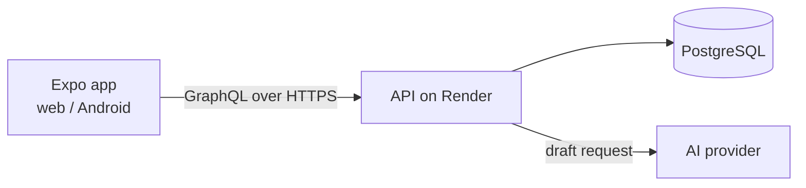

# Support Inbox

A small customer-support tool. Customers submit tickets without an account, and agents reply from a shared inbox and can draft replies with AI. One Expo codebase runs on web and Android.

**Live demo:** https://support-inbox-site.onrender.com

> The API runs on a free tier and sleeps when idle, so the first request after a quiet spell can take up to a minute. Please give it a moment. All data is fake, so please don’t enter real information.

## Features

- Public ticket form (no account needed) with a “Ticket sent” confirmation
- Agent signup and login (invite code required) with password hashing and JWT sessions
- Inbox with All / Open / Closed filters, showing the 50 newest tickets
- Ticket page with a reply thread and close/reopen
- **Draft with AI:** suggests a reply, which the agent edits before sending. Nothing is sent automatically, and there’s an Undo link.
- Runs on web and Android from one codebase (Android tested in Expo Go)

## Stack

| Layer | Tech |
|---|---|
| App (web + Android) | Expo, React Native, Expo Router, TypeScript |
| API | Node.js, GraphQL (GraphQL Yoga), TypeScript |
| Database | PostgreSQL (`pg`, plain SQL migrations) |
| Auth | bcryptjs password hashing, JWT |
| AI drafts | Groq API (`openai/gpt-oss-20b`), swappable via env vars |
| Hosting | Render (API and static site), `[your database host]` (free tiers) |



## Results (measured)

**Inbox query speed.** I generated 50,000 tickets in a local PostgreSQL 16 database and measured the inbox queries with `EXPLAIN (ANALYZE, BUFFERS)` before and after adding composite indexes. Each number is the median of 3 runs, taken on 21 Oct 2026.

| Query (newest 50) | Before (Seq Scan) | After (Index Scan) | Change |
|---|---|---|---|
| All tickets | 16.98 ms | 0.14 ms | about 120x |
| Open tickets | 17.64 ms | 0.16 ms | about 110x |

Before, Postgres read all 50,007 rows and sorted them. Now it reads the 50 newest rows already in index order. The indexes are in [`api/db/003_ticket_indexes.sql`](api/db/003_ticket_indexes.sql). The raw plans are in [`docs/benchmarks/`](docs/benchmarks/).

Caveats: this is local execution time on generated data with a warm cache. On the live site, network time and the API waking from sleep dominate, so users won’t see a 120x difference. The point is that query cost stays flat as the table grows.

<details>
<summary>How to reproduce</summary>

```sql
INSERT INTO tickets (subject, body, customer_email, status, created_at)
SELECT 'Test ticket ' || g, 'Generated body ' || g,
       'user' || (g % 5000) || '@example.com',
       CASE WHEN random() < 0.3 THEN 'open' ELSE 'closed' END,
       now() - random() * interval '90 days'
FROM generate_series(1, 50000) g;
ANALYZE tickets;

EXPLAIN (ANALYZE, BUFFERS) SELECT * FROM tickets ORDER BY created_at DESC LIMIT 50;
EXPLAIN (ANALYZE, BUFFERS) SELECT * FROM tickets WHERE status = 'open' ORDER BY created_at DESC LIMIT 50;
```

Run the two `EXPLAIN` queries three times before and after applying migration `003`, then compare the medians.
</details>

**Page speed.** PageSpeed Insights on the live login page (lab data, 20 Oct 2026):

| | Mobile | Desktop |
|---|---|---|
| Performance | 92 | 96 |
| Accessibility | 100 | 100 |
| Best Practices | 100 | 100 |
| SEO | 90 | 90 |

This covers the static site’s login page only, not the API’s cold start.

**Usage.** `[N]` testers submitted `[M]` tickets over `[period]`. *(Fill in from real counts, or delete this line.)*

## How I built this with AI

I used an AI assistant to scaffold code and help debug, and I ran and read everything it produced before keeping it. One place it was wrong: it set a default Groq model that Groq no longer offered to free accounts. The API returned a 404 `model_not_found`, I found the error in the server logs, checked Groq’s current model list, and switched to a model that’s available. I also made the model name configurable so a retired model is a one-line fix.

The draft feature is built to be safe by design. The system prompt tells the model to treat ticket text as untrusted customer content and never to invent refunds, policies or order details. The agent always reviews and edits the draft, and the API is limited to 10 drafts per agent per minute. `[Optional: add the result of your prompt-injection test ticket here, only if you ran it.]`

## Run locally

Requires Node 20+ and Docker (for Postgres).

```bash
git clone https://github.com/remm-max/support-inbox.git
cd support-inbox

# Database
docker run -d --name inbox-db \
  -e POSTGRES_USER=inbox -e POSTGRES_PASSWORD=inbox -e POSTGRES_DB=inbox \
  -p 5432:5432 postgres:16

# API
cd api
cp .env.example .env
npm install
npm run migrate && npm run seed
npm run dev            # http://localhost:4000/graphql
```

In a second terminal:

```bash
cd app
echo "EXPO_PUBLIC_API_URL=http://localhost:4000/graphql" > .env
npm install
npx expo start --web
```

- `AI_PROVIDER=mock` in `api/.env` (the default in `.env.example`) lets you try the Draft button with no account. For real drafts, set `AI_PROVIDER=groq` and `GROQ_API_KEY`.
- To test on a phone with Expo Go, set `EXPO_PUBLIC_API_URL` to your computer’s LAN IP (for example `http://192.168.1.20:4000/graphql`), keep both devices on the same Wi-Fi, and restart Expo. If the app can’t load, try `REACT_NATIVE_PACKAGER_HOSTNAME=<your LAN IP> npx expo start`.

## Configuration (API environment variables)

| Variable | Purpose |
|---|---|
| `DATABASE_URL` | PostgreSQL connection string |
| `JWT_SECRET` | Signs login tokens (required in production) |
| `SIGNUP_CODE` | Optional invite code required to create agent accounts |
| `CORS_ORIGIN` | Allowed web origin(s), comma-separated. Defaults to any origin if unset |
| `AI_PROVIDER` | `mock`, `groq`, `gemini` or `anthropic` |
| `GROQ_API_KEY` / `GEMINI_API_KEY` / `ANTHROPIC_API_KEY` | Key for the chosen provider |
| `AI_MODEL` | Optional model override (required for Gemini) |

On the web app, `EXPO_PUBLIC_API_URL` is baked in at build time.

## Project structure

```
support-inbox/
  api/    GraphQL API (src/), SQL migrations (db/)
  app/    Expo app: routes in src/app, data layer and auth in src/lib
  docs/   Screenshots and benchmark output
```

## Known limitations

- No rate limiting on login or on the public ticket form yet.
- Customers aren’t emailed when an agent replies, so there’s no customer-facing thread view.
- Replies are labelled “Agent” rather than with the agent’s name.
- The inbox shows the 50 newest tickets, with no pagination.
- On the web, the login token is kept in `localStorage`, which is simple but exposed to XSS. A production version should use httpOnly cookies.
- Free-tier hosting means cold starts, and free-tier AI limits can change without notice.
